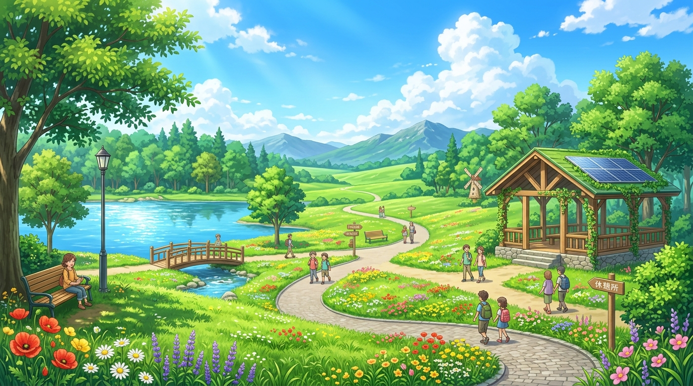

# EcoCoder Quest 🌿🤖
**Game Edukasi Pengelolaan Sampah & Dasar Algoritma**
*Berdasarkan PRD: EcoCoder Quest v1.0*



## 📌 Ringkasan Proyek
**EcoCoder Quest** adalah aplikasi game puzzle web interaktif yang dirancang khusus untuk siswa SMP. Game ini menggabungkan pembelajaran konsep **Computational Thinking** (sekuens logika dan perulangan *loop*) dengan pembiasaan **pemilahan sampah** (organik vs anorganik).

Pemain memandu relawan lingkungan anime **Rina** dan maskot peri daun **Koko** melintasi taman kota berukuran 5x5 untuk mengumpulkan sampah dan membuangnya ke tempat sampah yang sesuai menggunakan blok pemrograman visual.

---

## 🎮 Fitur Utama (Sesuai Kebutuhan PRD)

### 1. Papan Permainan 5x5 Zig-Zag (FR-01, FR-02)
- Pola penomoran zig-zag akurat dari petak 1 (kiri bawah) hingga petak 25 (kanan atas):
  ```
  21  22  23  24  25   (Baris 5 - Atas)
  20  19  18  17  16   (Baris 4)
  11  12  13  14  15   (Baris 3)
  10   9   8   7   6   (Baris 2)
   1   2   3   4   5   (Baris 1 - Bawah)
  ```
- Tombol toggle untuk menampilkan / menyembunyikan nomor petak (`🔢`).
- Karakter Rina selalu mulai di **petak 1** menghadap ke **kanan (timur)**.

### 2. Palet 6 Blok Perintah (FR-03, FR-04)
1. ➡️ **Maju 1 langkah** (Sekuens)
2. ↻ **Putar kanan 90°** (Arah Hadap)
3. ↺ **Putar kiri 90°** (Arah Hadap)
4. 🤲 **Ambil sampah** (Petak yang sedang diinjak)
5. 📥 **Letakkan sampah** (Hanya ke tong sampah yang jenisnya cocok)
6. 🔁 **Ulangi ... kali** (Perulangan 2-9 kali, proteksi non-nested loop)
- Mendukung **Drag-and-Drop** dan **Tap/Klik langsung** (ramah perangkat laptop maupun layar sentuh HP).

### 3. Eksekusi Program Beranimasi (FR-05, FR-07)
- Karakter bergerak mulus dari petak ke petak dengan rotasi hadap dan indikator sampah yang dibawa.
- Sorotan (glow) aktif pada blok perintah yang sedang dijalankan secara bertahap.
- Kontrol kecepatan animasi: **1x**, **2x**, **3x**.
- Tombol **Jalankan**, **Reset** (mengembalikan posisi tanpa menghapus kode), dan **Hapus**.

### 4. Sistem Deteksi Menang & Gagal Edukatif (FR-06)
- **Menang Langsung:** Terpicu saat seluruh sampah di papan berhasil dipilah ke tong yang benar tanpa harus menunggu sisa program.
- **Umpan Balik Debugging Ramah:**
  - Menabrak batu: *"Aduh! Ada batu di depan. Coba cari jalan lain."*
  - Keluar batas papan: *"Kamu keluar dari area! Cek lagi arah hadapmu."*
  - Salah tong sampah: *"Ups, jenis sampah tidak sesuai dengan tempat sampahnya!"*
  - Mengambil di petak kosong / tangan penuh: Arahan perbaikan yang membangun rasa ingin tahu.

### 5. 10 Level Terstruktur & Terverifikasi (FR-08)
Seluruh 10 level telah divalidasi dan diuji secara matematis menggunakan solver otomatis:
- **Level 1:** Langkah Pertama (Sekuens Lurus)
- **Level 2:** Belokan Cantik (Putar Kiri/Kanan)
- **Level 3:** Pilah Botol Plastik (Pengenalan Sampah Anorganik)
- **Level 4:** Hindari Rintangan (Navigasi Menghindari Batu)
- **Level 5:** Pilah Dua Jenis (Organik & Anorganik Sekaligus)
- **Level 6:** Kekuatan Loop (Pengenalan Blok Ulangi)
- **Level 7:** Pola Berulang (Loop Pola Tangga Gabungan)
- **Level 8:** Tiga Sampah di Taman (Perencanaan Rute Strategis)
- **Level 9:** Efisiensi Algoritma (Optimasi Blok Loop untuk 3 Bintang)
- **Level 10:** Misi Akhir: Eco Master! (Tantangan Puncak)

### 6. Sistem Bintang & Petunjuk 3 Tahap (FR-09)
- ⭐ Selesai
- ⭐⭐ Mendekati optimal
- ⭐⭐⭐ Optimal (jumlah blok referensi) dan tidak menggunakan petunjuk tahap 3.
- Petunjuk berjenjang: (1) Petunjuk umum, (2) Rekomendasi rute, (3) Cuplikan blok awal.

### 7. Kartu Edukasi Sampah (FR-10)
Setelah memenangkan level, pemain disajikan fakta menarik seputar sampah yang baru dipilah:
- Waktu dekomposisi / penguraian alami.
- Fakta ilmiah pengomposan atau daur ulang.
- Tips praktis 3R (*Reduce, Reuse, Recycle*) sehari-hari.

### 8. Tata Suara Web Audio API & BGM (FR-13)
- Efek suara sintetis tanpa aset audio eksternal: langkah kaki, putaran badan, koin ambil sampah, harmoni letakkan sampah, *fail cartoon wobble*, dan *fanfare* kemenangan ceria.
- Musik latar (*BGM*) prosedural cerah bertema anime dengan tombol *mute* dan penyimpanan otomatis di `localStorage`.

---

## 📁 Struktur Direktori
```
d:\game\
│
├── index.html                           # Struktur antarmuka HTML5 semantik & responsif
├── README.md                            # Dokumentasi lengkap proyek
├── PRD_Game_Edukasi_Pilah_Sampah.md     # Spesifikasi PRD asli
├── solver.py                            # Solver pathfinder pemverifikasi 10 level
├── test_levels.py                       # Skrip pengujian koordinat zig-zag & simulasi
│
├── assets/                              # Aset visual anime resolusi tinggi
│   ├── rina.jpg                         # Avatar karakter utama Rina
│   ├── mascot.jpg                       # Avatar maskot peri daun Koko
│   └── banner.jpg                       # Background pemandangan taman kota anime
│
├── css/
│   └── style.css                        # Desain sistem CSS modern, anime cerah, glassmorphism
│
└── js/
    ├── audio.js                         # Web Audio API Sound & BGM Synthesizer
    ├── levels.js                        # Definisi 10 level, petunjuk, & kartu edukasi
    ├── engine.js                        # Game logic, koordinat zig-zag, & interpreter
    ├── ui.js                            # UI Manager, drag-and-drop, modals & animations
    └── main.js                          # Inisialisasi aplikasi & event handlers
```

---

## 🚀 Cara Menjalankan Game
1. Buka terminal PowerShell di direktori `d:\game`.
2. Jalankan web server lokal menggunakan Python:
   ```powershell
   py -m http.server 8080
   ```
3. Buka browser favorit Anda (Google Chrome, Microsoft Edge, Firefox, Safari) dan akses:
   ```
   http://localhost:8080/index.html
   ```
4. Selamat bermain dan belajar bersama Rina dan Koko! 🌿🎉
